# Nonaki — AI Knowledge Base

A self-maintaining RAG (Retrieval-Augmented Generation) knowledge base.

[](https://vercel.com/new/clone?repository-url=https://github.com/prappo/nonaki-ai-knowledge-base&env=DATABASE_URL,DIRECT_URL,NEXT_PUBLIC_SUPABASE_URL,NEXT_PUBLIC_SUPABASE_ANON_KEY,WEAVIATE_URL,WEAVIATE_API_KEY,GROQ_API_KEY&envDescription=Required%20credentials%20for%20Supabase%2C%20Weaviate%20and%20Groq%20%E2%80%94%20see%20.env.example&envLink=https://github.com/prappo/nonaki-ai-knowledge-base/blob/main/.env.example)
[](https://app.netlify.com/start/deploy?repository=https://github.com/prappo/nonaki-ai-knowledge-base)

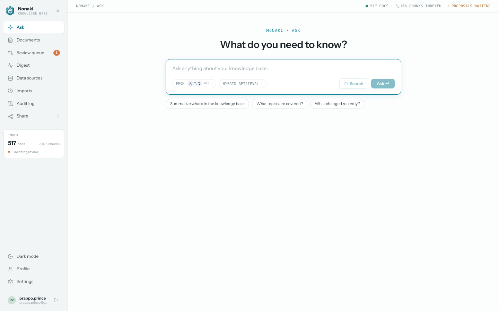

## Stack

| Concern | Technology |
|---|---|
| Framework | Next.js 16 (App Router, TypeScript, Tailwind v4) |
| Vector DB | **Weaviate Cloud** with the built-in `text2vec-weaviate` embedding service (or self-hosted Weaviate + `text2vec-transformers` via Docker — see below) |
| Answers & drafting | **Groq** free-tier LLMs (`groq-sdk`, streaming — default `llama-3.3-70b-versatile`) |
| Chunking | **LangChain** `RecursiveCharacterTextSplitter` (`@langchain/textsplitters`) |
| Metadata DB | **Supabase Postgres** via **Prisma 7** (sources, documents, proposals, sync/ask logs) |
| Auth | **Supabase Auth** (email + password, middleware-protected app; embeds & webhooks stay public) |
| File parsing | `pdf-parse` (PDF), `mammoth` (DOCX), plain text (TXT/MD) |

## Features

- **Ask (console)** — streaming RAG answers with numbered citations and a confidence meter. Hybrid (vector + BM25) retrieval from Weaviate.
- **Documents** — every indexed page, issue, upload and manual entry in one searchable, filterable table. Open one to read it, see its version history, or ask the built-in assistant to revise it.
- **Data sources**
  - **WordPress import** — paste a site URL; published posts & pages are pulled from the public REST API (`/wp-json/wp/v2`), stripped to text, chunked and indexed.
  - **GitHub import** — connect a public or private repo (via a fine-grained PAT); open issues & PRs are pulled in, chunked and indexed.
  - **File uploads** — PDF / DOCX / TXT / MD, parsed → chunked → indexed.
  - **Manual entries** — notes written directly in Nonaki, chunked & indexed like everything else.
- **Maintenance & approval flow** — re-syncing a source detects changed or removed content and queues **proposals** instead of silently updating:
  - side-by-side diff of current vs proposed content
  - **Approve & publish** → document version bumps, content is re-chunked with LangChain and re-indexed in Weaviate
  - **Reject** → the indexed version is kept
  - archive proposals remove a document's chunks from Weaviate
- **Doc assistant** — ask the AI to revise any document; the draft lands in the review queue as a proposal.
- **Maintenance digest** — weekly stats, pending decisions, recent approvals, live activity feed.
- **Import history** — every import & sync job, what it did and what broke, with one-click retry.
- **Audit log** — every important action (settings, syncs, approvals, profile changes) with who did it and when.
- **Share** — publish the knowledge base beyond the console:
  - **Chat widget** — an embeddable `<script>` widget, themeable, scoped to chosen sources.
  - **Chatbot** — connect the knowledge base to Facebook Messenger (Instagram DM, WhatsApp, Telegram planned).
  - **Knowledge base site** — a public, themeable help-center generated from indexed docs, searchable and optionally AI-powered.
- **Settings** — pick an AI provider (Groq, OpenAI, Claude, DeepSeek), toggle thinking mode, chunk size, retrieval depth.
- **Profile** — account details and per-provider AI token usage.
- **Auth** — email + password sign-in, middleware-protected app (embeds & webhooks stay public).

## Screens

<table>
<tr>
<td width="50%"><br><sub><b>Ask</b> — streaming answers with citations</sub></td>
<td width="50%">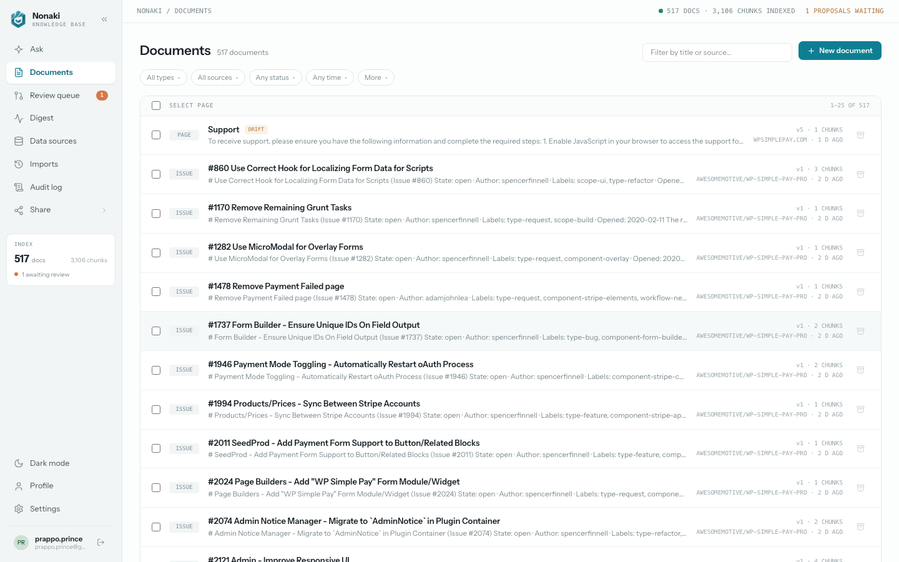<br><sub><b>Documents</b> — every indexed item, filterable</sub></td>
</tr>
<tr>
<td width="50%">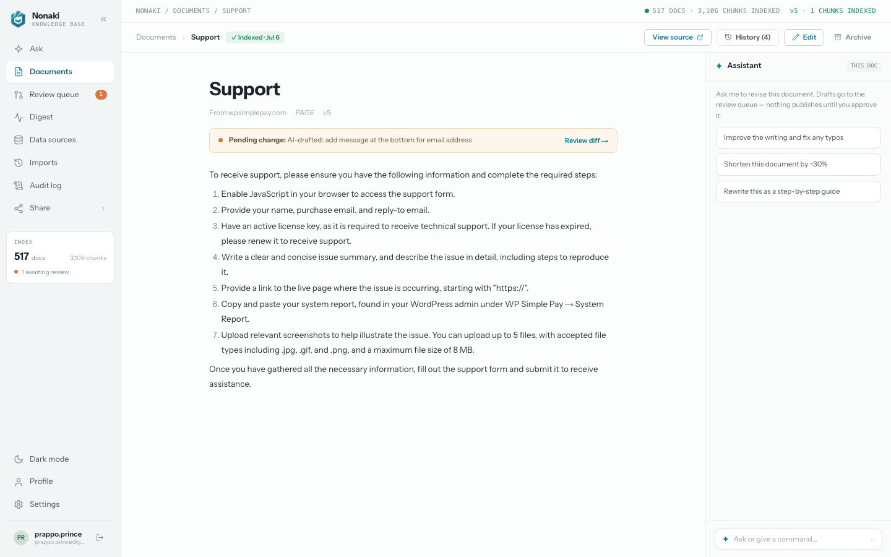<br><sub><b>Document detail</b> — read, version history, AI revise</sub></td>
<td width="50%">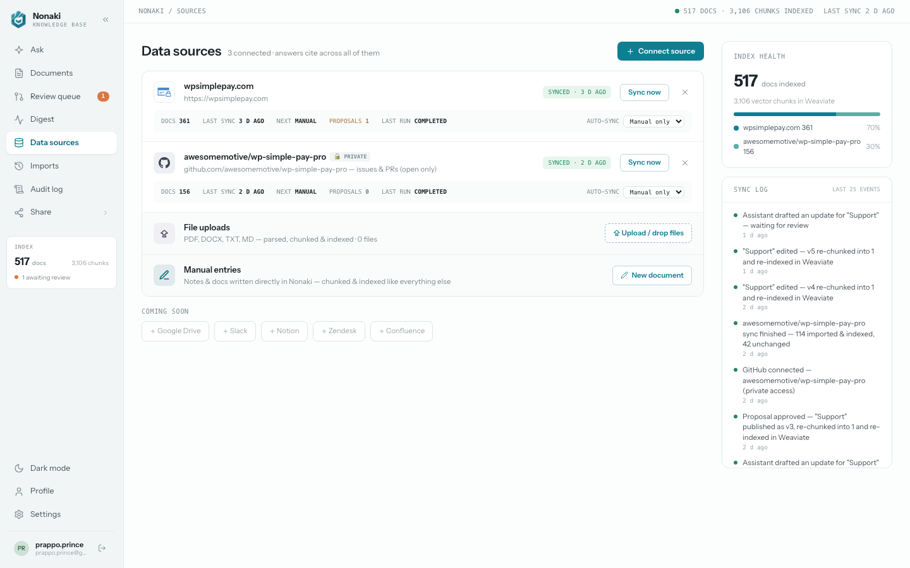<br><sub><b>Data sources</b> — WordPress, GitHub, uploads, manual</sub></td>
</tr>
<tr>
<td width="50%">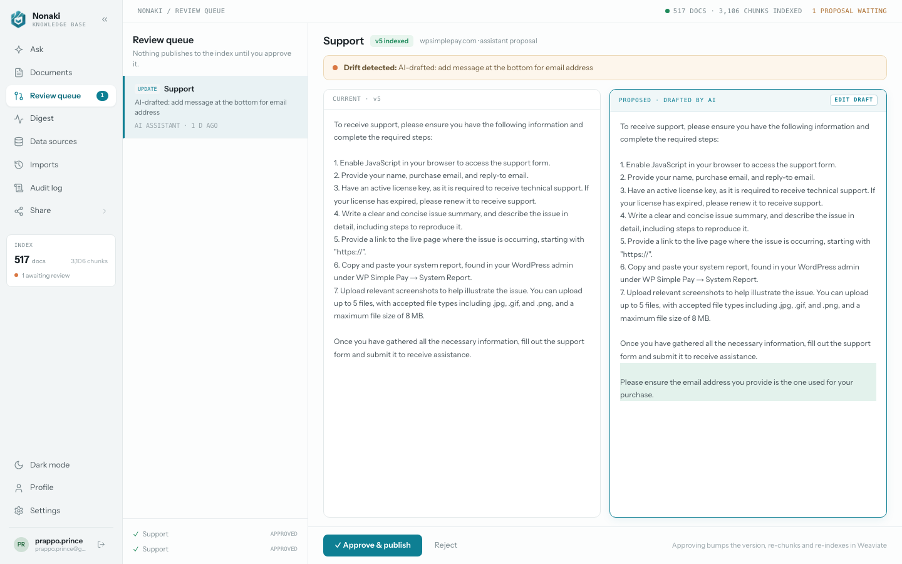<br><sub><b>Review queue</b> — diff, approve & publish, or reject</sub></td>
<td width="50%">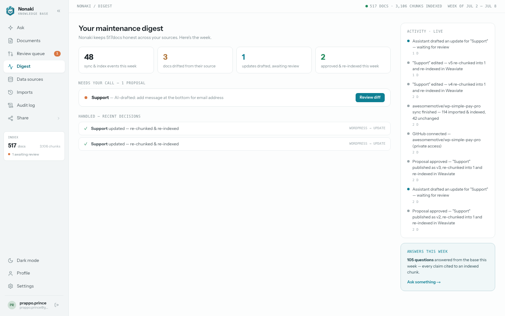<br><sub><b>Maintenance digest</b> — weekly stats & live activity</sub></td>
</tr>
<tr>
<td width="50%">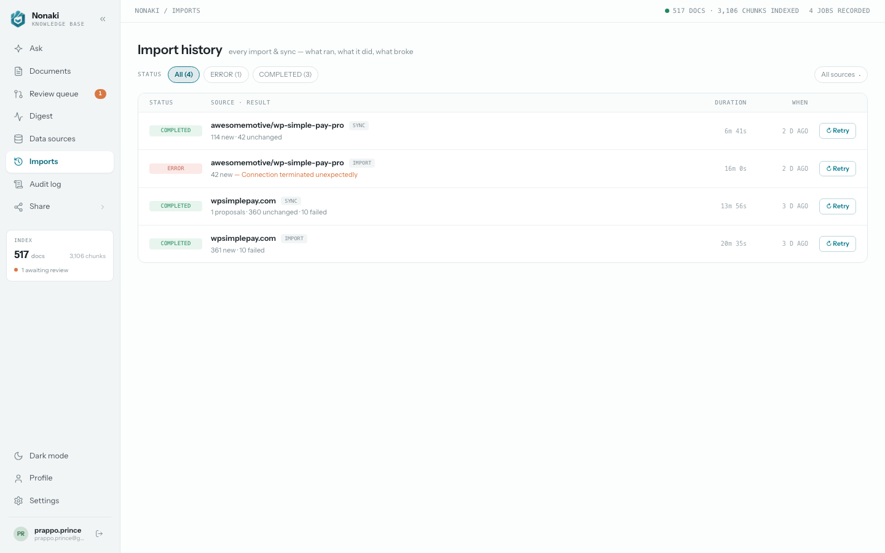<br><sub><b>Import history</b> — every job, what broke, retry</sub></td>
<td width="50%">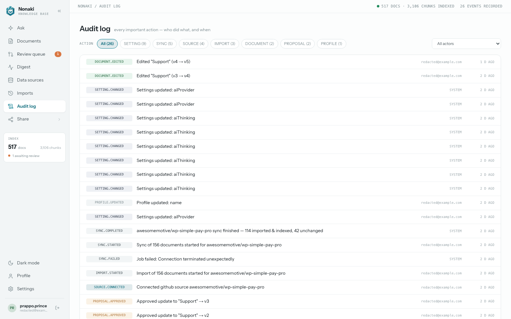<br><sub><b>Audit log</b> — every action, who and when</sub></td>
</tr>
<tr>
<td width="50%">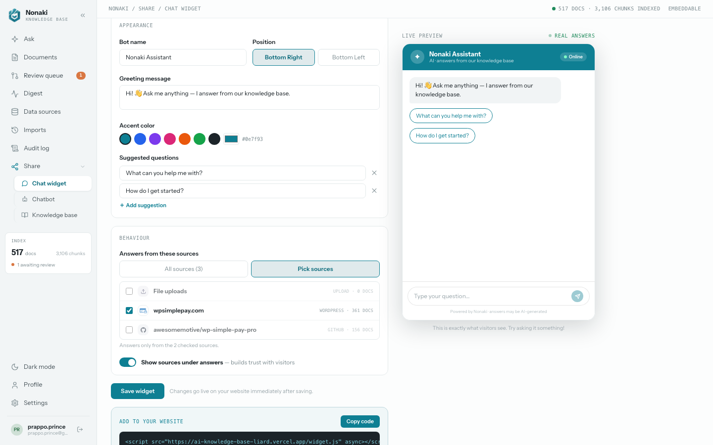<br><sub><b>Chat widget</b> — embeddable, themeable, scoped</sub></td>
<td width="50%">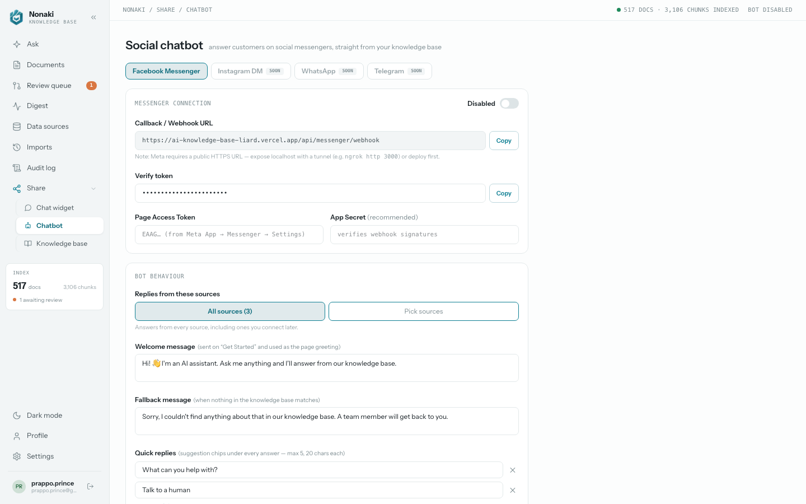<br><sub><b>Chatbot</b> — Facebook Messenger integration</sub></td>
</tr>
<tr>
<td width="50%">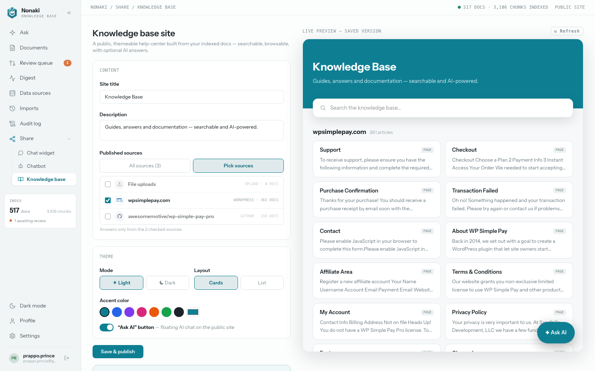<br><sub><b>Knowledge base site</b> — public, themeable help center</sub></td>
<td width="50%">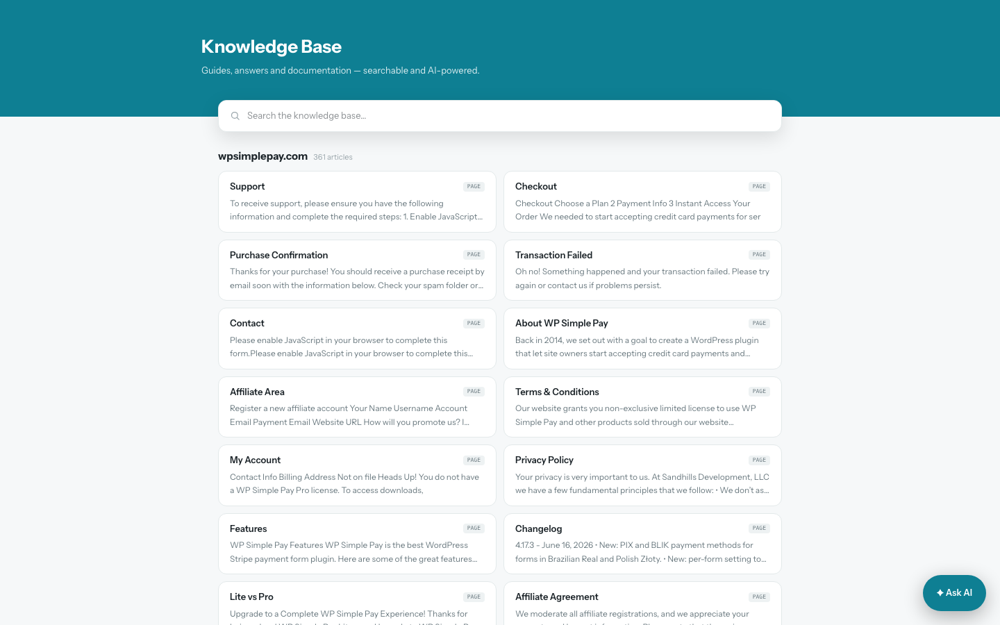<br><sub><b>Embedded KB site</b> — what visitors see</sub></td>
</tr>
<tr>
<td width="50%">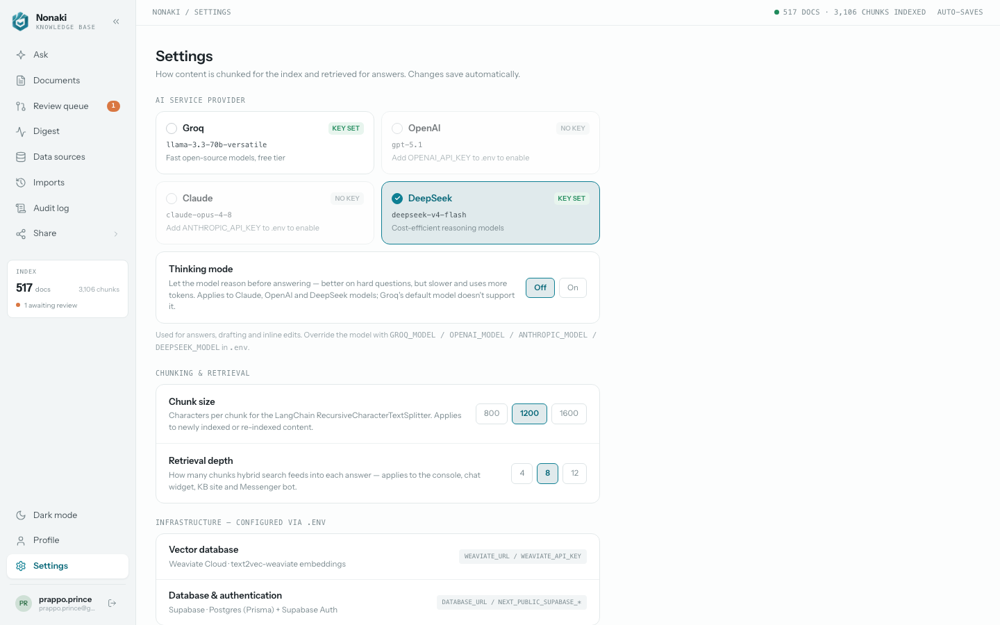<br><sub><b>Settings</b> — AI provider, chunking, retrieval</sub></td>
<td width="50%">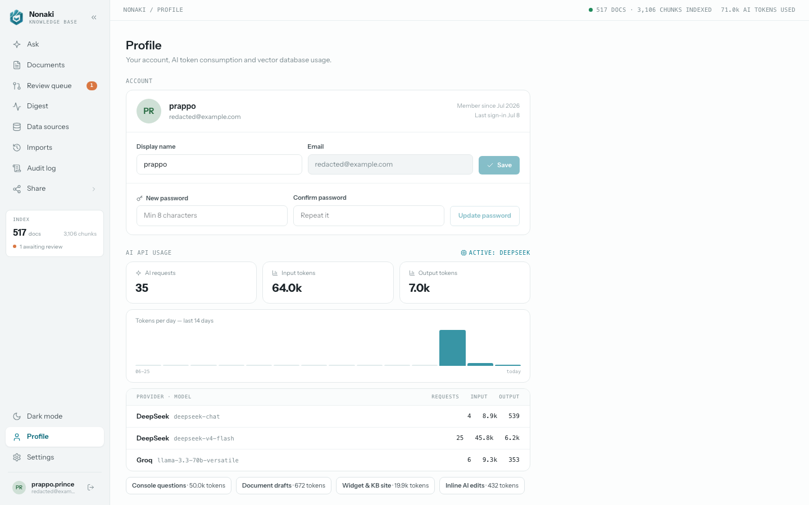<br><sub><b>Profile</b> — account & AI token usage</sub></td>
</tr>
<tr>
<td align="center" colspan="2">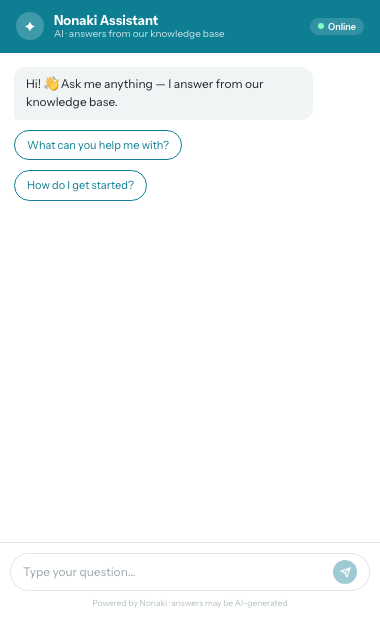<br><sub><b>Embedded chat widget</b> — what visitors see</sub></td>
</tr>
</table>

## Setup

```bash
# Node 24 (via nvm)
nvm use 24

# install (note: if NODE_ENV=production is set in your shell, force dev deps)
NODE_ENV=development npm install --include=dev

# database
npx prisma migrate dev
```

Fill in `.env` (see `.env.example`):

```env
DATABASE_URL="postgresql://...pooler.supabase.com:6543/postgres"   # Supabase → Database → Transaction pooler
DIRECT_URL="postgresql://...pooler.supabase.com:5432/postgres"     # Session pooler (for prisma migrate)
NEXT_PUBLIC_SUPABASE_URL="https://<project>.supabase.co"           # Supabase → Settings → API
NEXT_PUBLIC_SUPABASE_ANON_KEY="eyJ..."
WEAVIATE_URL="https://<cluster>.weaviate.cloud"   # console.weaviate.cloud → free sandbox
WEAVIATE_API_KEY="..."                             # cluster admin API key
GROQ_API_KEY="gsk_..."                             # console.groq.com (free)
GROQ_MODEL="llama-3.3-70b-versatile"               # any free Groq model
```

First run: sign up at `/login`, then (optionally) disable further sign-ups in
Supabase → Authentication → Sign In / Up.

Migrating from the old SQLite setup? `npm run db:migrate-data` copies
everything from `dev.db` into Supabase, preserving document IDs so existing
Weaviate chunks stay linked.

The `Chunk` collection in Weaviate is created automatically on first use, configured with the `text2vec-weaviate` embedding service (no separate embedding provider needed).

## Run

```bash
npm run dev    # http://localhost:3000
```

## Run fully locally with Docker

`docker-compose.yml` runs everything — Postgres, Auth, Weaviate, and its
embedding model — in containers on your machine. The **only** thing that
still leaves the Docker network is the AI provider call itself
(Groq/OpenAI/Anthropic/DeepSeek); this is a separate stack from your regular
`.env`/cloud setup and doesn't touch it.

```bash
cp .env.docker.example .env.docker
# fill in at least one AI provider key (e.g. GROQ_API_KEY) in .env.docker
docker compose --env-file .env.docker up --build
```

Then open `http://localhost:3000` and sign up — Auth auto-confirms new
accounts locally (no SMTP server). Weaviate uses the self-hosted
`text2vec-transformers` module (a small sentence-transformer model, ~90MB)
for embeddings instead of Weaviate Cloud's service — nothing leaves the
network for that step either.

Services: `app` (this repo), `postgres` (`supabase/postgres`, also backs
Auth), `auth` (`supabase/gotrue`), `kong` (routes `/auth/v1/*` to Auth,
matching what the app's Supabase client expects), `weaviate`, and
`t2v-transformers` (the local embedding model).

## Go to production

Everything above is fine for your own machine, but three things need to
change before this is reachable from the internet: real TLS, secrets that
aren't sitting in a public GitHub repo, and not exposing Postgres/Weaviate's
raw ports. `docker-compose.prod.yml` is an overlay that handles all three —
it adds a [Caddy](https://caddyserver.com) reverse proxy (automatic
Let's Encrypt cert, renews itself) and removes every other service's direct
port publishing, so only Caddy's 80/443 are reachable from outside.

**1. Point a domain at the server**, then generate secrets that were never
committed anywhere:

```bash
cp .env.docker.example .env.docker
# delete the JWT_SECRET/ANON_KEY lines .env.docker.example ships with, then:
./docker/generate-secrets.sh >> .env.docker
echo 'DOMAIN=your-domain.com' >> .env.docker
# fill in an AI provider key (e.g. GROQ_API_KEY) same as before
```

**2. Rebuild the app image with that domain baked in** — `NEXT_PUBLIC_SUPABASE_URL`
is inlined into the browser bundle at build time, so this step can't be
skipped even though the compose overlay also sets it at runtime:

```bash
ANON_KEY=$(grep '^ANON_KEY=' .env.docker | cut -d'"' -f2)
docker build -t prappo/nonaki-ai-knowledge-base:latest \
  --build-arg NEXT_PUBLIC_SUPABASE_URL="https://your-domain.com" \
  --build-arg NEXT_PUBLIC_SUPABASE_ANON_KEY="$ANON_KEY" .
```

**3. Bring up the full stack with the production overlay:**

```bash
docker compose -f docker-compose.yml -f docker-compose.prod.yml \
  --env-file .env.docker up -d
```

Auth and the app both route through Caddy on the same domain — `/auth/v1/*`
goes to Kong, everything else to the app (see `docker/Caddyfile`) — so there's
only one cert to manage, no separate Auth subdomain needed.

**After it's up:** sign up once at `https://your-domain.com/login`, then set
`GOTRUE_DISABLE_SIGNUP=true` in `.env.docker` and re-run step 3 to lock out
further signups. Also worth setting up before relying on this for real data:
a periodic `pg_dump` of the `postgres` volume and a backup of the
`weaviate_data` volume — neither is automated here.

## Flow

```
WordPress / GitHub / uploads ──▶ parse ──▶ LangChain chunker ──▶ Weaviate (text2vec-weaviate)
                                                                     │
             Ask ──▶ hybrid retrieval ──▶ Groq LLM ──▶ streamed, cited answer
                                                                     │
Source re-sync ──▶ drift detected ──▶ proposal (diff) ──▶ approve ──▶ re-chunk + re-index
                                                       └──▶ reject  ──▶ keep current
```
